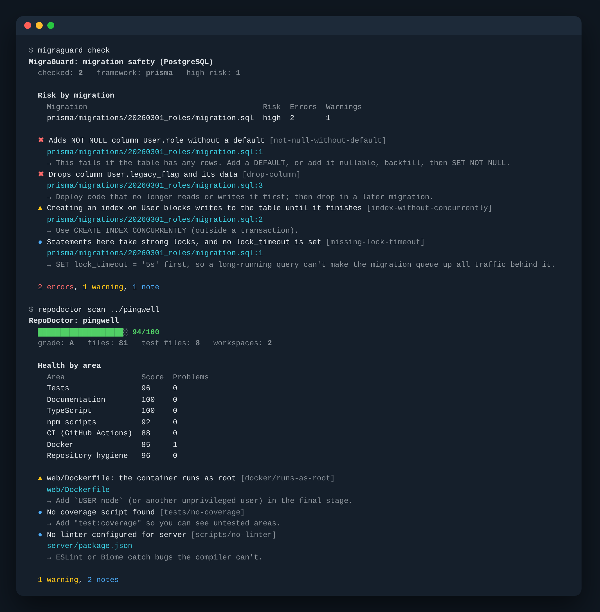

# DevDoctor

Eight pre-production checks for JavaScript and TypeScript projects, in one package with no config required.

| Tool | What it catches | Command |
| --- | --- | --- |
| **RepoDoctor** | Missing tests and docs, loose TypeScript, broken npm scripts, weak CI and Docker setups. Produces a 0–100 health score. | `repodoctor scan ./` |
| **MigraGuard** | Destructive or lock-heavy PostgreSQL migrations (plain SQL, Prisma, Drizzle, Knex) before they deploy | `migraguard check ./migrations` |
| **PulseAPI** | API regressions: chained requests, environments, JSON Schema and timing assertions, written in YAML | `pulseapi run ./api-tests` |
| **DepScope** | Duplicate, unused, undeclared, heavy and outdated npm dependencies, and import cycles | `depscope analyze` |
| **EnvDoctor** | Missing, undocumented, unused or invalid environment variables, checked across `.env`, Zod, Docker and CI. Values are never printed. | `envdoctor check` |
| **CommitSmith** | Messy history and committed secrets. Suggests and lints Conventional Commits and writes changelogs. | `commitsmith suggest` |
| **ArchWatch** | Imports that cross architecture boundaries, deep imports into modules, and circular imports | `archwatch check` |
| **LogLens** | Groups thousands of log lines into a short list of distinct problems, recurring exceptions and bursts | `loglens analyze ./logs/app.log` |

```bash
npm install --save-dev @wealthometer/devdoctor
npx @wealthometer/devdoctor check          # every static tool that applies to this repo, one exit code
```

Every tool is also installed as its own command (`npx migraguard …`) and is available as `devdoctor <tool> …`.



```text
$ migraguard check
MigraGuard: migration safety (PostgreSQL)
  checked: 2   framework: prisma   high risk: 1

  Risk by migration
    Migration                                       Risk  Errors  Warnings
    prisma/migrations/20260301_roles/migration.sql  high  2       1

  ✖ Adds NOT NULL column User.role without a default [not-null-without-default]
    prisma/migrations/20260301_roles/migration.sql:1
    → This fails if the table has any rows. Add a DEFAULT, or add it nullable, backfill, then SET NOT NULL.
  ✖ Drops column User.legacy_flag and its data [drop-column]
    prisma/migrations/20260301_roles/migration.sql:3
    → Deploy code that no longer reads or writes it first; then drop in a later migration.
  ▲ Creating an index on User blocks writes to the table until it finishes [index-without-concurrently]
    prisma/migrations/20260301_roles/migration.sql:2
    → Use CREATE INDEX CONCURRENTLY (outside a transaction).

  2 errors, 1 warning, 1 note
```

## Shared behaviour

Every tool works the same way:

- **Output.** `--format text` (default), `json`, `markdown` (for PR comments) or `sarif` (for GitHub code scanning). Use `--output report.md` to write the report to a file.
- **Exit codes.**
  - `0`: nothing at or above the `--fail-on` severity (`error` by default; also `warning`, `info`, `none`).
  - `1`: findings at or above that severity.
  - `2`: usage or configuration error.
- **Findings.** Each finding has a stable rule id, a severity, a file and line where there is one, and a one-line hint on how to fix it.
- **Config.** Optional. Put it in `devdoctor.config.json` (or `.ts`/`.js`/`.mjs`, or a `"devdoctor"` key in package.json), with one section per tool. Anything under `"ignore"` (rule ids, files, or `rule:file`) is dropped from reports. There's a JSON Schema at `node_modules/@wealthometer/devdoctor/schemas/devdoctor.schema.json` for editor autocomplete, and a complete example in [examples/devdoctor.config.json](examples/devdoctor.config.json).
- **Output streams.** Progress messages go to stderr, so stdout stays clean for piping.

---

## RepoDoctor

```bash
repodoctor scan ./ [--min-score 80] [--skip docker]
```

RepoDoctor grades seven areas and averages them by weight. Areas that don't apply, such as Docker in a repo without a Dockerfile, are left out instead of counting against the score. Monorepo workspaces are checked package by package.

| Area | Examples of what it checks |
| --- | --- |
| Tests | No test files; npm's placeholder `test` script; scripts that can't fail (`--passWithNoTests`, `\|\| true`); low test-to-source ratio; no coverage script |
| Documentation | No README, or a thin one; no setup instructions; no LICENSE; code that reads env vars but no `.env.example` |
| TypeScript | Missing tsconfig; strict mode off (resolving `extends`); strict flags turned back off; no type-check script (bundlers don't check types); piles of `any` and `@ts-ignore` |
| npm scripts | Scripts that call binaries no dependency provides; `npm run x` where `x` doesn't exist; `node scripts/missing.js`; no lockfile, or several; no `engines` |
| CI | No workflows; invalid YAML; CI that never runs tests or the type checker; no `pull_request` trigger; actions pinned to `@main`; secrets echoed in logs; `pull_request_target` checking out PR code; end-of-life Node; no job timeouts |
| Docker | Untagged or `:latest` images; running as root; secrets in `ENV`/`ARG`; `ADD <url>`; dependency layers invalidated by `COPY . .`; no `.dockerignore`, or one that lets `.env` into the build; privileged Compose services; passwords written into Compose files |
| Hygiene | `.env`, private keys or `node_modules` committed (checked with `git ls-files`); `.gitignore` gaps; files over 5 MB; no formatter config |

`--min-score` adds an error when the score is below the threshold, so CI can enforce a floor.

## MigraGuard

```bash
migraguard check [dir…] [--since origin/main] [--framework prisma|drizzle|knex|sql] [--pg-version 16]
```

MigraGuard finds migrations on its own (`prisma/migrations`, `drizzle`, `migrations`, `db/migrations`, `supabase/migrations`, …) and reads them in apply order. Drizzle migrations are ordered by `meta/_journal.json`.

- **Destructive operations:** `DROP TABLE`, `DROP COLUMN`, `TRUNCATE`, `DELETE` or `UPDATE` without `WHERE`, `DROP SCHEMA`, and renaming a table or column (which breaks the code version that is still running during a deploy).
- **Unsafe column changes:** adding a `NOT NULL` column with no default; volatile defaults (`now()`, `gen_random_uuid()`) and `serial` columns that rewrite the table; type changes; `SET NOT NULL` (suggests the `CHECK … NOT VALID` route); foreign keys and checks added without `NOT VALID`; unique or primary-key constraints that build an index under lock.
- **Expensive index operations:** `CREATE INDEX`, `DROP INDEX` or `REINDEX` without `CONCURRENTLY`; `CONCURRENTLY` inside a transaction (which fails, including in runners that wrap each file in one); `VACUUM FULL`, `CLUSTER` and `LOCK TABLE`; strong locks taken without a `lock_timeout`.
- **Design notes:** tables without a primary key, 32-bit integer primary keys, `json` instead of `jsonb`, and `timestamp` without a time zone.

Tables created in the same file are new and empty, so lock-related rules don't apply to them. With `--since`, every migration added since that ref is treated as one batch that deploys together, so tables it creates are also new.

**Knex** migrations are code, so MigraGuard reads the schema builder statically: `createTable`, `alterTable`, `dropTable`, column chains (`.notNullable()` without `.defaultTo()`, `.alter()`, `.index()`, `.references()`), `knex('t').del()`, and any `knex.raw(...)` SQL. It also understands `config = { transaction: false }`. It reads `up()` only.

**Risk:** each file gets a risk level (none, low, medium or high) based on its findings. To accept a risky statement deliberately, put this on the line above it:

```sql
-- migraguard-ignore: drop-column
ALTER TABLE users DROP COLUMN legacy_flag;
```

In CI, run `migraguard check --since origin/main` to check only new migrations, since migrations that have already been applied can't be changed.

## PulseAPI

```bash
pulseapi run [dir|file…] [--env staging] [--var baseUrl=http://localhost:3000] [--junit report.xml] [--bail] [--grep users]
pulseapi send POST https://api.example.com/users -H "Authorization: Bearer {{$env.TOKEN}}" --json '{"name":"Ada"}'
pulseapi init
```

Suites are YAML or JSON files. Requests run top to bottom, and values captured from one response feed later requests:

```yaml
name: Users API
baseUrl: "{{baseUrl}}"
requests:
  - name: Create a user
    method: POST
    url: /users
    headers: { Authorization: "Bearer {{$env.API_TOKEN}}" }
    json: { email: "{{$randomEmail}}", name: Ada }
    expect:
      status: 201                 # or [200, 201], or "2xx" (the default)
      maxDuration: 500            # ms
      headers: { content-type: /json/ }
      json:
        $.id: { exists: true }
        $.name: Ada
        $.tags.length: { gte: 1 }
      schema: ./schemas/user.json # JSON Schema (draft-07 or 2020-12), file or inline
    capture:
      userId: $.id
      etag: header.etag

  - name: Fetch it
    url: /users/{{userId}}
    expect: { json: { $.id: "{{userId}}" } }
```

- **Assertions:** literal values, `/regex/`, or operators: `eq`, `ne`, `gt`, `gte`, `lt`, `lte`, `contains`, `matches`, `exists`, `type`, `length`, `oneOf`.
- **Variables:** `{{name}}` reads suite variables, captures, `--var` values and the environment chosen with `--env` (from `pulseapi.environments` in config). `{{$env.NAME}}` reads the process environment, which keeps secrets out of files. `{{$uuid}}`, `{{$timestamp}}`, `{{$isoTimestamp}}`, `{{$randomInt}}`, `{{$randomEmail}}` and `{{$randomName}}` generate values.
- **Per request:** `query`, `form`, `body`, `timeout`, `retries` and `skip` are also available.
- **Reports:** a results table, failures as findings with the suite line number, and `--junit` for CI test reports.

## DepScope

```bash
depscope analyze [--offline] [--registry URL] [--type-cycles]
depscope graph [--modules] [--depth 2] [--graph-format mermaid|dot] [--focus express]
```

- **Unused dependencies:** a dependency counts as used if it is imported, called as a binary from a script, mentioned in config files (ESLint, Babel and PostCSS plugins by their short names), loaded by name in code (logger transports, plugins), implicitly needed (`typescript`, `@types/node`), or a peer dependency of something you use. Anything else is reported. Unused production dependencies are warnings; unused devDependencies are notes.
- **Undeclared dependencies:** imports that only work because something else installed the package.
- **devDependencies in production code:** reported for libraries and servers. Bundled front-end apps are skipped, because everything is bundled there anyway.
- **Duplicates:** read from `package-lock.json`, `pnpm-lock.yaml` or `yarn.lock` (v1 and Berry), with a fallback to walking `node_modules`.
- **Size:** each direct dependency's on-disk weight, including everything it pulls in.
- **Outdated and deprecated:** checked against the npm registry (it honours `npm_config_registry`, uses timeouts, and runs 8 requests at a time). Use `--offline` to skip this.
- **Import cycles:** one shortest representative loop per tangle, plus how many files are involved.
- **Graphs:** Mermaid or Graphviz output of the package tree (duplicates highlighted) or of your own modules (cycles highlighted).

Workspaces are analysed package by package. Workspace packages that depend on each other are never reported as undeclared.

## EnvDoctor

```bash
envdoctor check [--env .env --env .env.production] [--example .env.example] [--schema src/env.ts] [--process]
```

- **Missing, empty and invalid values:** your env files are compared with `.env.example`.
- **Types:** annotate the example with comments, or define types in config (`envdoctor.vars`):

  ```dotenv
  # @type url
  DATABASE_URL=postgres://localhost/app
  PORT=3000 # @type port
  LOG_LEVEL=info # @type debug|info|warn|error
  # @optional
  SENTRY_DSN=
  ```

  Available types: string, number, integer, port, boolean, url, email, json, duration, host, and `a|b|c` lists. `pattern`, `min` and `max` work in config.
- **Zod:** point `--schema` at a TS or JS file that exports your schema (`envSchema`, `schema`, or the default export). It's loaded with your own dependencies, and `.optional()` and `.default()` make a variable optional. Zod messages are stripped of received values.
- **Code:** finds `process.env.X`, `process.env["X"]`, `import.meta.env.X`, `Deno.env.get`, `Bun.env` and destructuring. It reports variables the code reads that aren't documented, and documented variables nothing reads. Unused-variable checks are skipped when config is loaded generically, as in `schema.parse(process.env)`.
- **Docker and CI:** Compose services that build your app but don't set a required variable; variables that Compose or GitHub workflows set but nobody documented. Variables referenced as `${VAR}` in Compose files and Dockerfiles count as used.
- **Secrets:** real-looking secrets committed in the example file (Stripe, AWS, GitHub, Slack, OpenAI and Anthropic keys, private keys, URLs with passwords, high-entropy values) are reported masked as `sk…(32 chars)`. No report ever contains a value from your `.env`.
- **Deploy time:** `--process` validates the live environment, which is useful as a container entrypoint or a deploy step.
- **Monorepos:** workspace packages with their own `.env.example` are checked on their own.

## CommitSmith

```bash
commitsmith suggest [--raw]            # git commit -m "$(commitsmith suggest --raw)"
commitsmith lint "feat(api): add search" | --file .git/COMMIT_EDITMSG | --from origin/main
commitsmith changelog [--from v1.2.0] [--version 1.3.0] [--write CHANGELOG.md] [--all]
commitsmith scan [--all] [--include-tests]
commitsmith hook [--uninstall]         # commit-msg → lint, pre-commit → scan
```

- **suggest** reads the staged diff and picks the commit type:
  - docs, test, ci and build when only those kinds of files changed;
  - style for whitespace-only changes;
  - feat for new files, exports or routes;
  - refactor for moves and removals;
  - fix or perf based on what the changes contain.

  The scope comes from the common package or `src/<area>` folder. Removed exports produce `!` and a `BREAKING CHANGE` footer. The suggestions are a starting point to edit, not an oracle.
- **lint** enforces the Conventional Commits format, allowed types and scopes (configurable), a header length limit, the blank line before the body, and the breaking-change footer format. It also warns about trailing periods, capitalised subjects, non-imperative verbs ("added") and vague subjects ("wip"). Merge, revert and fixup commits pass.
- **changelog** groups commits since the last tag into breaking changes, features, fixes, performance and so on, links commits when the remote is on GitHub or GitLab, and suggests the next version (following semver's 0.x convention). `--write` prepends the entry to an existing file.
- **scan** blocks staged sensitive files (`.env`, private keys, cloud credentials, Terraform state, database files) and secrets in added lines, reported masked. Test files and fixtures are skipped unless you pass `--include-tests`. A deliberate line can carry `commitsmith-ignore`.
- **hook** installs the git hooks, honouring `core.hooksPath`. It appends to existing hooks instead of overwriting them.

## ArchWatch

```bash
archwatch init       # suggest a config from your folders
archwatch check [--type-only]
archwatch graph [--files] [--graph-format mermaid|dot]
```

```json
{
  "archwatch": {
    "layers": { "domain": "src/domain/**", "app": "src/app/**", "infra": "src/infra/**", "ui": "src/ui/**" },
    "rules": [
      { "from": "domain", "allow": [], "message": "the domain layer must not depend on anything" },
      { "from": "ui", "disallow": ["infra"] },
      { "from": "src/features/*", "disallow": ["src/features/*"], "allowSameMatch": true }
    ],
    "forbidden": [{ "from": "src/ui/**", "import": ["node:*", "pg"], "message": "no server modules in the browser" }],
    "modules": [{ "module": "src/features/*", "entry": ["index.ts"] }],
    "cycles": "error"
  }
}
```

- **Rules** refer to layers or directly to globs. A `*` in a glob captures a name, so `allowSameMatch` lets a feature import itself but not its siblings.
- **`forbidden`** bans packages, Node builtins (`node:*`) or paths, scoped to the importing files.
- **`modules`** makes folders reachable only through their entry files, which stops deep imports into another module's internals.
- **Resolution:** imports are resolved the way TypeScript resolves them: extensions, `index` files, `.js` to `.ts` (NodeNext), and tsconfig `paths` and `baseUrl`.
- **Type-only imports** are ignored unless you pass `--type-only`, since they don't create runtime dependencies.
- **Output:** a table of dependencies between layers, with violation counts.

## LogLens

```bash
loglens analyze ./logs/app.log [--level warn] [--since 6h] [--until 2026-05-01T12:00:00Z] [--grep timeout] [--field service=api] [--csv groups.csv]
kubectl logs deploy/api | loglens analyze -
```

- **Formats:**
  - JSON lines from pino, bunyan, winston and ECS;
  - logfmt (Go, logrus, Docker);
  - NestJS, Python logging, log4j-style lines, syslog, and Apache/nginx access logs (5xx counts as an error);
  - dev-server output with colour codes;
  - `.gz` files and folders of logs.
- **Stack traces and errors:** stack traces are attached to their entry. A "request failed:" line followed by `Error: …` counts as one event.
- **Grouping:** errors are grouped by type, message pattern (ids, numbers, emails, IPs, UUIDs, quoted values and URLs normalised) and the first stack frame in your own code.
- **Output:**
  - counts by level, the time range and the error rate;
  - the top problems, with first and last seen times;
  - bursts: minutes with far more errors than usual;
  - optional CSV export of every group.

---

## In CI

```yaml
# .github/workflows/checks.yml
name: Checks
on: pull_request
permissions:
  contents: read
  security-events: write   # for SARIF upload
jobs:
  devdoctor:
    runs-on: ubuntu-latest
    timeout-minutes: 10
    steps:
      - uses: actions/checkout@v4
        with: { fetch-depth: 0 }          # MigraGuard --since and CommitSmith --from need history
      - uses: actions/setup-node@v4
        with: { node-version: 22, cache: npm }
      - run: npm ci
      - run: npx @wealthometer/devdoctor check --format sarif --output devdoctor.sarif --fail-on none
      - uses: github/codeql-action/upload-sarif@v3
        with: { sarif_file: devdoctor.sarif, category: devdoctor }
      - run: npx @wealthometer/devdoctor check                                  # fails the job on errors
      - run: npx migraguard check --since origin/${{ github.base_ref }}
      - run: npx commitsmith lint --from origin/${{ github.base_ref }}
      - run: npx envdoctor check --schema src/env.ts
```

The repository also ships a composite action (`action.yml`) that runs a command and uploads SARIF in one step.

## Programmatic use

```ts
import { checkMigrations, scanRepo, analyzeLogs, render } from "@wealthometer/devdoctor"

const report = await scanRepo(process.cwd())
console.log(report.score, report.findings.length)
console.log(render(report, "markdown"))
```

Every command is also a function that returns `{ tool, title, summary, findings, sections, score? }`.

## Limits worth knowing

- **Heuristics:** MigraGuard's Knex support, CommitSmith's type guesses, DepScope's unused detection and LogLens's text-format parsing are heuristic. They're tuned to avoid noise, and every rule can be ignored by id.
- **Databases:** MigraGuard targets PostgreSQL. Most destructive-change rules also make sense for MySQL, but lock behaviour differs.
- **Platforms:** tested on Linux and macOS with Node 20, 22 and 24.

## Development

```bash
npm install
npm test               # 72 tests: real git repos, an HTTP server, temp projects
npm run test:coverage
npm run build && node bin/devdoctor.js check   # the tools check this repo too
```

## Publishing and the website

See [PUBLISHING.md](PUBLISHING.md) for releasing to npm. The landing page is `site/index.html`, deployed to GitHub Pages by `.github/workflows/pages.yml`.

## License

MIT
